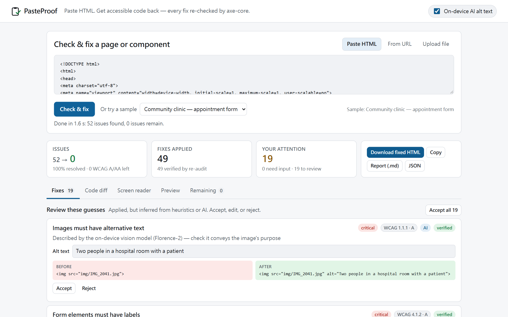

# PasteProof

**Paste inaccessible HTML. Get accessible code back. Every fix is re-checked.**



**Live demo:** https://cs113062273-bot.github.io/CTRL-V-Hackathon-2026/ — runs entirely in your browser (paste, upload, samples, on-device AI). Fetching a URL needs the local app (`npm start`).

PasteProof audits a web page or component with [axe-core](https://github.com/dequelabs/axe-core) (WCAG 2.2 A/AA + best practices) plus its own checks, repairs the **source HTML and CSS**, then re-renders and re-audits the result. Every change is marked *verified* or *still failing*, and layout and text are measured to be unchanged. Guesses go to a review queue where you accept, edit, or reject them.

It is not an overlay: nothing is injected at runtime. You get plain HTML, a diff, a CSS patch for your stylesheets, and a report.

## Who it helps

- **Screen-reader users**: images, fields, buttons, and links get real names.
- **Keyboard and switch users**: mouse-only controls become focusable and operable.
- **Low-vision users**: contrast is fixed and zoom blocking is removed.
- **Voice-control users**: spoken names match the visible labels.
- **People with motor or memory impairments**: form fields declare `autocomplete`.
- **Teams without an accessibility specialist**: clinics, schools, city services, and nonprofits get fixed code instead of a list of problems.

94.8% of the top million home pages fail WCAG ([WebAIM Million 2025](https://webaim.org/projects/million/2025)).

## Quick start

Requires Node 18+ and Chrome, Edge, or Chromium. No API keys or paid services.

```bash
npm install
npm start            # http://127.0.0.1:5173
```

There are four ways to get a page in:

- **Ctrl+V anywhere** on the page pastes and runs.
- **From URL** renders the page in headless Chrome, so JavaScript-built sites work. Private network addresses are blocked.
- The **Send to PasteProof** bookmarklet sends any open page, including pages behind a login.
- **Upload or drop** an `.html` file, or pick one of the four samples.

**On-device AI alt text** (optional) runs Florence-2 in the browser through Transformers.js. The model is a one-time download of about 300 MB, and images never leave your machine.

## Views

| View | Purpose |
|---|---|
| **Fixes** | Each change with its WCAG criterion, impact, confidence, and reason. Groups: *Needs input* → *Review* → *Applied* → *Optional*. Edit, reject, or apply, then re-run. |
| **Code diff** | HTML diff plus a CSS patch for external stylesheets. |
| **Screen reader** | What a screen reader announces, before and after. |
| **Preview** | Original and fixed pages side by side. |
| **Remaining** | Issues still failing and items that need a human check. |
| **Export** | Fixed HTML, Markdown report, JSON report, and CSS patch. |

## What it repairs

| Area | Repair |
|---|---|
| Contrast (1.4.3) | Smallest same-hue colour change. Edits the CSS rule that sets the colour; for external CSS, adds an override and writes a patch. Every edit is verified in the CSSOM. |
| Images (1.1.1) | Text inside SVGs, decorative detection, redundant alt removal, link destinations, captions, AI captions. If none of these applies, it asks you. |
| Forms (1.3.1, 3.3.2, 1.3.5) | Connects visible labels, replaces placeholder-only labels, marks required fields, adds `autocomplete`. |
| Names (4.1.2, 2.4.4, 2.5.3) | Names from icon classes, SVG titles, link destinations, and handler names; fixes names that don't contain the visible text. |
| Keyboard (2.1.1) | Mouse-only `onclick` elements get a role, `tabindex`, and an Enter/Space handler. |
| Structure | `lang`, `<title>`, landmarks, unique landmark names, skip link, heading levels (no visual change), lists, ARIA errors, zoom blocking. |
| Target size (2.5.8) | Offered as an optional suggestion, because it changes layout. |

## CLI

```bash
node cli.js page.html -o page.accessible.html --json report.json
node cli.js https://example.org --fail-on serious   # non-zero exit if serious issues remain (for CI)
```

## Tests and evaluation

```bash
npm test       # contrast math, image naming, human-review round trip, UI self-audit
npm run eval   # 21 pages incl. 13 live public-service sites and W3C's demo pages
```

On 21 pages, the evaluation found 1,604 issues, 15 of which remain after fixing (683 target-size suggestions are optional and not applied). All 781 applied fixes were verified, no fix introduced a new issue, and text and layout were 100% preserved. Full results are in [EVALUATION.md](EVALUATION.md).

`npm run build:static` writes a static build to `dist/` for any static host. The static build has every feature except URL fetching.

## Architecture

```
public/engine/pipeline.js   audit → fix → re-render → re-audit, per-fix verification, layout check
public/engine/audit.js      script-free, CSP-locked sandbox + axe-core; screen-reader view
public/engine/fixers.js     repairs per rule
public/engine/*.js          contrast math, name inference, language detection, AI worker
public/app.js               UI (no framework, no build step)
server.js                   static files + guarded fetch of pages, images, stylesheets
cli.js, lib/                same engine in headless Chrome/Edge
eval/run.js                 evaluation harness
```

Pages are audited with all scripts, inline handlers, and `javascript:` URLs removed, under a CSP that only allows the bundled axe-core. Every request the fetch proxy and headless renderer make is checked against loopback and private ranges (`PASTEPROOF_ALLOW_PRIVATE=1` allows a local dev server).

## Limitations

- Automated checks cover only part of WCAG; also test with a keyboard and a screen reader.
- Framework source (JSX, templates) is not rewritten; apply the diff and CSS patch by hand.
- One page at a time.

## License

MIT. Uses axe-core (MPL-2.0), jsdiff (BSD-3-Clause), puppeteer-core (Apache-2.0), Transformers.js (Apache-2.0), and Florence-2 (MIT). Sample photos are public domain (Wikimedia Commons).
